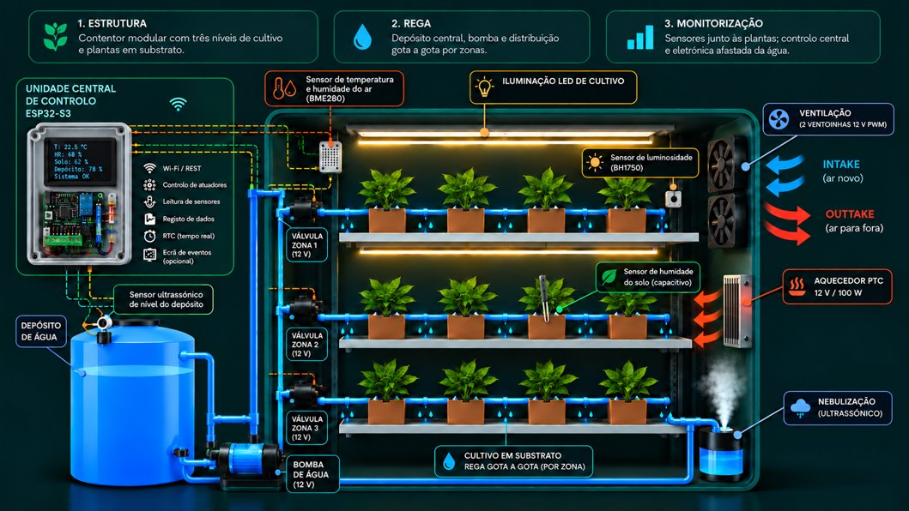

# GreenBox AI

**PBL • 5.º semestre • 2026/2027**

### Agricultura Urbana – Estufa Inteligente

Sistema distribuído de monitorização, automação e otimização de recursos para agricultura urbana em contentor.

| Cultivo em substrato | Depósito + bomba | ESP32-S3 |
|---|---|---|
| Prateleiras verticais Rega gota a gota | Distribuição de água Válvulas por zona | Controlo local Sensores • IA |

**Unidades Curriculares:** Sistemas Distribuídos • Computação Física e IoT • Inteligência Artificial • Engenharia de Software

**Elementos do grupo:**

| Nome | Número |
|---|---|
| Fernando Simões | 20241477 |
| Cláudio Fonseca | 20240628 |
| Vítor Hugo Freitas | 20241067 |

**Universidade Europeia** • Licenciatura em Engenharia Informática • Grupo g03

**Palavras-chave:** agricultura urbana, contentor agrícola, IoT, ESP32, rega inteligente, eficiência energética, IA

**GitHub:** https://github.com/CaluFonseca/GreenBox

---

## 1. Resumo e enquadramento

A GreenBox AI propõe uma estufa vertical instalada num contentor, concebida para agricultura urbana em ambiente controlado. As plantas serão cultivadas em substrato e irrigadas por rega gota a gota. A instalação integra sensores, microcontroladores ESP32, atuadores, armazenamento de dados e Inteligência Artificial (IA).

O sistema monitoriza a humidade do substrato, a temperatura e a humidade do ar, a luminosidade, o nível de água e o consumo elétrico. Com base nestes dados, automatiza a rega por zonas, controla a iluminação e a ventilação e o aquecimento. Os dados são enviados por uma API REST para um servidor local, que os guarda numa base de dados MySQL e os apresenta num painel web.

### Problema identificado

A rega por horários fixos ou observação visual pode desperdiçar água. Em paralelo, a iluminação artificial, a bomba e a ventilação podem consumir energia sem coordenação com as condições reais. Sem histórico, é difícil compreender o comportamento da estufa, antecipar necessidades e identificar falhas.

### Objetivo geral

Conceber um sistema distribuído de monitorização e controlo para uma estufa vertical em contentor, reduzindo desperdícios de água e energia, mantendo condições de cultivo adequadas e usando dados históricos e meteorológicos para produzir previsões e recomendações.

### Objetivos específicos

- Recolher leituras ambientais e de humidade do substrato em intervalos regulares.
- Automatizar a rega por zonas, com limites temporais e bloqueio em caso de falta de água.
- Controlar iluminação e ventilação por horários e limites ambientais configuráveis.
- Registar estados dos atuadores e medir o consumo elétrico nos circuitos instrumentados.
- Transmitir e armazenar dados via REST/MySQL e apresentá-los num painel web.
- Desenvolver IA para previsão do consumo energético e deteção de anomalias no ciclo de rega.

Esta milestone define a proposta, os requisitos preliminares, as tecnologias, a arquitetura conceptual, o artefacto físico e o plano de trabalho. A solução será refinada nas etapas seguintes.

### Enquadramento nas unidades curriculares

O projeto integra as quatro unidades curriculares do 5.º semestre, cada uma responsável por uma parte da solução:

| Unidade curricular | Contributo para a GreenBox AI | Secções do relatório |
|---|---|---|
| Sistemas Distribuídos | Gestão do projeto (planeamento, milestones, GitHub). Arquitetura distribuída: nós periféricos ESP32-S3-WROOM-CAM ligados ao nó central ESP32-S3 por ESP-NOW; nó central e nós com câmara ligados por Wi-Fi (rede local) a um servidor local que aloja a aplicação web, a API REST, a base de dados, o dashboard, a IA e o armazenamento de imagens. Tolerância a falhas com regras locais e buffer (a validar no protótipo). | 6, 9 |
| Computação Física e IoT | Programação dos ESP32. Integração de sensores (humidade do substrato, BME280, BH1750, nível ultrassónico, INA219) e atuadores (bomba, válvulas, ventoinhas, LED, nebulizador, aquecedor). Envio dos dados por REST para a base de dados MySQL. | 3, 4, 5 |
| Inteligência Artificial | Tratamento dos dados dos sensores e da Open-Meteo (fonte externa). Previsão do consumo energético a 24 h e deteção de anomalias no ciclo de rega, acrescentando funcionalidades ao dispositivo. | 7 |
| Engenharia de Software | Especificação dos requisitos funcionais e não funcionais, guiões de utilização e plano de testes e validação. | 2, 8 |

## 2. Público-alvo e guiões de utilização

### Público-alvo

- Pessoas que pretendem produzir hortícolas ou ervas aromáticas em espaços urbanos limitados.
- Hortelões urbanos e pequenos produtores interessados em automatizar tarefas e acompanhar consumos.
- Escolas e instituições de ensino que pretendam demonstrar IoT, sistemas distribuídos e IA.
- Projetos de agricultura urbana que necessitem de uma unidade modular de cultivo em ambiente controlado.

### Benefícios esperados

| Dimensão | Benefício esperado |
|---|---|
| Água | Rega acionada pela humidade do substrato e por zona. |
| Ambiente | Registo contínuo de temperatura, humidade do ar e luminosidade. |
| Energia | Medição do consumo e previsão de períodos de maior utilização. |
| Fiabilidade | Regras essenciais executadas localmente, mesmo sem Internet. |
| Manutenção | Alertas para depósito vazio e comportamento anómalo da rega. |
| Conhecimento | Histórico para avaliar padrões e melhorar parâmetros. |

### Guião 1 — Rega automática

**Pré-condições:** estufa ligada, depósito com água e sensor operacional.

**Passos:**
1. O utilizador abre o painel e consulta a humidade.
2. A leitura desce abaixo do limite configurado.
3. O controlador valida o nível do depósito e o tempo máximo permitido.
4. Ativa a bomba e a válvula da zona.
5. Volta a ler a humidade e desliga a rega.
6. Regista o evento e o consumo disponível.

**Resultado esperado:** rega condicionada às necessidades e às proteções, com evento registado.

### Guião 2 — Depósito baixo e perda de rede

**Passos:**
1. O nível do depósito desce abaixo do limite.
2. O controlador bloqueia a bomba e gera alerta.
3. A ligação Wi-Fi é interrompida.
4. O controlo local mantém as proteções e guarda dados localmente, se o buffer estiver implementado.
5. A ligação regressa e os dados pendentes são enviados.
6. O utilizador consulta o histórico e repõe a água.

**Resultado esperado:** a bomba não funciona sem água e a falha de rede não desativa as proteções.

## 3. Funcionalidades propostas

| ID | Funcionalidade | Descrição preliminar |
|---|---|---|
| F01 | Monitorização do substrato | Ler sensores capacitivos por zona e disponibilizar valores ao controlador. |
| F02 | Rega automática por zonas | Acionar bomba central e válvulas conforme humidade, com tempo máximo por ciclo. |
| F03 | Proteção do depósito | Medir nível e bloquear a bomba quando a água for insuficiente. |
| F04 | Monitorização ambiental | Medir temperatura e humidade do ar; leitura exterior prevista como extensão. |
| F05 | Ventilação | Acionar ventoinhas quando os valores ultrapassarem limites configurados. |
| F06 | Iluminação | Controlar luz por horário e luminosidade ambiente. |
| F07 | Gestão temporal | Usar RTC para manter horários sem Internet. |
| F08 | Monitorização energética | Registar corrente/potência nos circuitos compatíveis e estimar energia por intervalo. |
| F09 | API e persistência | Validar dados REST e guardar leituras, estados, alertas e consumo em MySQL. |
| F10 | Painel web | Apresentar estado, histórico, gráficos e alertas. |
| F11 | Previsão energética por IA | Prever o consumo das próximas 24 horas com histórico e dados meteorológicos. |
| F12 | Deteção de anomalias por IA | Analisar a resposta da humidade após rega e identificar comportamentos inesperados. |
| F13 | Recomendações | Sugerir ajustes quando existirem dados suficientes para sustentar a recomendação. |
| F14 | Humidificação ambiental automática | Ativar o nebulizador ultrassónico quando a humidade desce abaixo do limite definido, desligando-o ao atingir o objetivo ou perante nível de água insuficiente. |

### Possíveis extensões

A estimativa de biomassa/crescimento por visão computacional poderá ser explorada numa fase posterior, através de câmara fixa e análise da área foliar. Não é requisito essencial do protótipo inicial.

## 4. Hardware e lista preliminar de material

A lista consolida o documento do grupo e a apresentação. Quantidades, preços e compatibilidades são preliminares e devem ser confirmados antes da compra.

*Figura 1 – Esboço do artefacto físico: estufa vertical em contentor com três zonas de cultivo e servidor local.*

| Componente | Qtd. preliminar | Finalidade |
|---|---|---|
| ESP32-S3 DevKit + expansão | 1 | Nó central: regras locais, coordenação, Wi-Fi, REST e controlo central. |
| ESP32-S3-WROOM-CAM | Até 3 | Nós periféricos junto às zonas de cultivo; comunicação ESP-NOW e captura de imagens. |
| Servidor local (mini-PC) | 1 | Alojar a aplicação web, a API REST, a base de dados, o dashboard, a IA e o armazenamento de imagens. |
| Sensores capacitivos de humidade | 3 | Uma leitura por zona/prateleira, sujeita ao desenho final. |
| Sensores BME280 | 2 | Temperatura/humidade do ar interior e exterior; exterior opcional no início. |
| Sensor luminosidade BH1750 | 1 | Medição de luz ambiente. |
| Sensor ultrassónico de nível | 1 | Estimativa do nível/percentagem de água do depósito. |
| Bomba de água de baixa tensão | 1 | Pressurizar a linha principal de rega. |
| Válvulas solenoides 12 V, normalmente fechadas | 2 ou mais | Selecionar a zona a irrigar; quantidade a confirmar. |
| Kit gota a gota, tubos e acessórios | 1 conjunto | Distribuir água às plantas cultivadas em substrato. |
| Ventoinhas ARCTIC P12 Pro 12 V PWM | 2 | Circulação/extração de ar; interface PWM a validar. |
| Aquecedor ventilado 12 V / 100 W | 1 | Controlo automático da temperatura e da ventilação. |
| Fita LED de cultivo | 1 m ou por prateleira | Iluminação suplementar; potência a validar. |
| RTC DS3231 | 1 | Manter horários sem depender da Internet. |
| INA219 | 2, indicativo | Medição em circuitos compatíveis; verificar limites elétricos. |
| Módulos MOSFET/relés e proteções | Conforme circuitos | Comutar atuadores com dimensionamento adequado. |
| Fontes 12 V e 5 V + conversores | 1 conjunto | Alimentar atuadores e eletrónica. |
| Estrutura, depósito, suportes e cablagem | 1 conjunto | Estrutura vertical e montagem. |
| Nebulizador ultrassónico de baixa tensão | 1 | Produzir névoa para aumentar a humidade do ar. |

> **Nota:** o INA219 não deve ser ligado a cargas acima dos seus limites.

## 5. Software e tecnologias

| Camada | Tecnologias propostas | Responsabilidade |
|---|---|---|
| Firmware ESP32 | MicroPython (provisório) | Leitura de sensores, regras locais, atuadores e comunicação entre nós. |
| Comunicação entre nós | ESP-NOW | Troca de leituras/comandos entre periféricos e nó central. |
| Ligação à rede | Wi-Fi + HTTPS | Enviar dados e imagens ao servidor local e permitir consulta do painel. |
| Servidor | Servidor local | Alojar a aplicação web, a API, a base de dados, o dashboard, a IA e as imagens. |
| API | Python + FastAPI | Endpoints REST, validação e resposta a pedidos. |
| Base de dados | MySQL | Persistir leituras, estados, alertas, energia e resultados da IA. |
| Armazenamento de imagens | Sistema de ficheiros do servidor local | Guardar as fotografias enviadas pelos nós com câmara. |
| Dashboard | HTML, CSS, JavaScript, Chart.js | Estado atual, histórico, eventos, alertas e previsões. |
| IA e análise | Python, pandas, scikit-learn | Preparação de dados, previsão energética e deteção de anomalias. |
| Fonte meteorológica | Open-Meteo API | Temperatura exterior e radiação solar, conforme endpoint disponível. |
| Desenho/simulação | Wokwi, diagrams.net, EasyEDA | Simulação parcial e documentação de arquitetura/circuitos. |
| Gestão do projeto | GitHub | Versionamento, documentação Markdown, issues e acompanhamento. |

### Princípios de implementação

- Separar regras críticas de segurança da dependência de serviços online.
- Validar valores recebidos e rejeitar leituras impossíveis ou inconsistentes.
- Usar identificação da zona e timestamps consistentes nas leituras.
- Uma falha de API não deve ativar atuadores nem impedir as proteções locais.
- Implementar buffer local para envio posterior, se a capacidade for confirmada no protótipo.

As tecnologias são provisórias e serão confirmadas durante a prototipagem. ESP-NOW e Wi-Fi devem ser configurados e testados para coexistir no mesmo canal quando usados simultaneamente pelo nó central.

## 6. Arquitetura computacional distribuída

A arquitetura separa aquisição física, controlo local, persistência e análise. O ESP32-S3 funciona como nó central; os ESP32-S3-WROOM-CAM são distribuídos pelas zonas de cultivo. A comunicação periférico-central será feita por ESP-NOW. O central aplica regras locais e, quando existe ligação, envia dados à API REST por Wi-Fi. A aplicação web, a API, a base de dados, o dashboard, a IA e o armazenamento de imagens correm num servidor local, o que dá maior estabilidade ao sistema; os ESP32 ficam responsáveis pela automação, pelos sensores e pelos atuadores.

| Componente | Função |
|---|---|
| Nós periféricos | Recolher humidade do substrato e comunicar com o central; acionar válvulas conforme o desenho final; captar imagens da zona e enviá-las ao servidor local. |
| Servidor local | Alojar a aplicação web, a API REST, a base de dados MySQL, o dashboard, o serviço de IA e o armazenamento de imagens. |
| Nó central ESP32-S3 | Coordenar os nós, aplicar regras de segurança e controlar bomba, iluminação, ventilação, humidificação. |
| API REST / FastAPI | Receber, validar e disponibilizar leituras e eventos. |
| Base de dados MySQL | Guardar leituras, estados, alertas, medições energéticas e resultados de IA. |
| Dashboard web | Mostrar estado atual, histórico, gráficos e alertas. |
| Serviço de IA | Prever consumo energético e detetar anomalias usando dados da estufa e meteorologia. |
| Open-Meteo | Fornecer dados meteorológicos adicionais, como temperatura exterior e radiação solar. |

### Fluxo de funcionamento

- Os periféricos recolhem humidade do substrato e reportam os valores ao ESP32-S3.
- O central valida leituras, aplica regras de segurança e controla os atuadores.
- A API valida e persiste os dados em MySQL; o dashboard consulta a API para apresentar estado e histórico.
- O serviço de IA combina dados da estufa com dados meteorológicos para produzir previsões e alertas.

O nebulizador é ativado quando a humidade relativa do ar desce abaixo do limite definido e é desligado quando o objetivo é atingido, o nível de água é insuficiente ou termina o tempo máximo de funcionamento. A ventilação deve ser coordenada com a humidificação para evitar excesso de humidade. O aquecedor, caso seja incluído no protótipo, terá limites de temperatura, tempo de funcionamento e proteção próprios; a sua ligação depende da validação elétrica e térmica.

Em falha de Internet, o controlo básico e as proteções devem continuar localmente. O envio posterior depende da implementação e validação de um buffer; esta capacidade é um objetivo de desenho, não uma funcionalidade já demonstrada.

## 7. Inteligência Artificial

A componente de IA terá duas linhas prioritárias: previsão do consumo energético para as 24 horas seguintes e deteção de anomalias no ciclo de rega. Ambas dependem de dados de qualidade e de observações reais suficientes. A IA complementa as regras de controlo, mas não substitui as proteções locais.

### 7.1 Previsão do consumo energético

**Variável-alvo:** consumo elétrico agregado por hora, em Wh por intervalo horário, mantendo unidade consistente.

**Entradas:** temperatura e humidade do ar, luminosidade, estado e duração da bomba/ventoinhas/LED, medições elétricas disponíveis, hora do dia e dados meteorológicos Open-Meteo, como temperatura exterior e radiação solar.

**Preparação:** validar tipos e unidades, tratar leituras em falta, identificar outliers, alinhar timestamps, agregar por hora e separar treino/teste cronologicamente.

**Modelos a comparar:** baseline de média por hora do dia, regressão linear e Random Forest. A utilização de uma rede neuronal LSTM será considerada apenas se existirem dados históricos suficientes e regulares. A qualidade das previsões será avaliada através da comparação entre os valores previstos e os valores reais, utilizando como referência um modelo de previsão mais simples e calculando o erro médio das previsões.

### 7.2 Deteção de anomalias no ciclo de rega — requisito prioritário

Após o acionamento da bomba e da válvula de uma zona, o sistema observa a evolução da humidade do substrato e compara-a com o comportamento esperado. Uma subida inexistente ou demasiado lenta pode indicar depósito vazio, bomba sem caudal, tubo obstruído, válvula avariada ou sensor com problema. Uma subida abrupta e implausível pode indicar leitura inválida ou avaria do sensor.

**Abordagem inicial:** definir uma janela de observação e limites de plausibilidade com base na variação de humidade, estado da bomba e nível do depósito. Quando existirem dados suficientes, poderá treinar-se um modelo simples de anomalias. O evento deve gerar alerta e colocar o sistema num estado seguro, por exemplo bloqueando nova rega até validação.

### 7.3 Extensões

Poderá estudar-se a previsão da velocidade de secagem do substrato a partir de temperatura, humidade do ar, luz e histórico de rega. A estimativa de biomassa por câmara fixa poderá relacionar crescimento e necessidade hídrica, mas não faz parte do núcleo mínimo.

**Limitação:** inicialmente não haverá dados suficientes para garantir previsões fiáveis. Até existir histórico adequado, os modelos serão experimentais e as decisões críticas continuarão baseadas em limites seguros configurados.

## 8. Requisitos preliminares e gestão de riscos

### Requisitos funcionais (RF)

| ID | Requisito preliminar |
|---|---|
| RF01 | Recolher periodicamente leituras dos sensores ligados. |
| RF02 | Controlar a rega por zona segundo a humidade e limites configuráveis. |
| RF03 | Impedir a bomba de funcionar quando o nível de água for insuficiente. |
| RF04 | Limitar a duração de cada ciclo de rega e registar o evento. |
| RF05 | Monitorizar temperatura, humidade do ar e luminosidade. |
| RF06 | Controlar iluminação e ventilação por horários e limites. |
| RF07 | Transmitir leituras/eventos por REST e guardá-los em MySQL. |
| RF08 | Apresentar estado, histórico, alertas e dados energéticos disponíveis. |
| RF09 | Produzir previsão energética e métricas quando existirem dados adequados. |
| RF10 | Detetar comportamento anómalo após a rega e gerar alerta/ação segura. |
| RF11 | Manter controlo básico e proteções sem Internet. |
| RF12 | Regular a humidade relativa do ar através da ativação automática do nebulizador, com limites configuráveis e proteções de segurança. |

### Requisitos não funcionais (RNF)

- **Segurança:** baixa tensão sempre que possível, fusíveis/proteções e eletrónica separada da água.
- **Fiabilidade:** falhas de rede/API não podem provocar acionamento inseguro.
- **Integridade:** validar valores, timestamps e identificação de cada zona.
- **Manutenibilidade:** código versionado, módulos separados e documentação no GitHub.
- **Observabilidade:** guardar estados, alertas e eventos para diagnóstico.

### Matriz de riscos

| Risco | Impacto | Mitigação |
|---|---|---|
| Falta de água | Dano na bomba / falta de rega | Sensor de nível, bloqueio e tempo máximo. |
| Sensor avariado | Rega excessiva/insuficiente | Validar intervalos e detetar leituras implausíveis. |
| Falha Wi-Fi/API | Perda temporária de dados remotos | Regras locais e buffer, se implementado. |
| Obstrução da rega | Zona sem água | Deteção de anomalia pela resposta da humidade. |
| Água na eletrónica | Danos elétricos | Separação física, cablagem protegida e fontes adequadas. |
| Poucos dados para IA | Previsões pouco fiáveis | Recolher dados desde o protótipo e comparar baseline. |
| Aquecedor / sobrecarga | Consumo elevado ou falha de alimentação | Aquecedor 12 V / 100 W. |
| Excesso de humidade | Desenvolvimento de fungos e danos nas plantas. | Desligar o nebulizador ao atingir o limite definido e coordenar com a ventilação. |
| Falha de comunicação entre sensores e controlador | Leituras indisponíveis ou controlo incorreto. | Detetar falhas de comunicação e aplicar valores de segurança. |
| Falha do ESP32 | Interrupção da rega, ventilação e humidificação automáticas. | Implementar reinício automático e estado seguro dos atuadores. |

## 9. Plano de trabalho e calendarização

O planeamento é preliminar e será atualizado à medida que as tarefas forem concluídas. As datas seguem o briefing do projeto.

| Período / data | Atividades principais | Responsabilidade preliminar |
|---|---|---|
| Até 27/10/2026 — M1 | Consolidar o problema, o objetivo e o âmbito do protótipo; fechar a arquitetura conceptual, a lista preliminar de materiais, o esboço físico, os guiões de utilização, os riscos, o relatório e a apresentação. | Todos; consolidação do relatório e da apresentação pelo grupo. |
| Até 13/11/2026 — ES | Formalizar os requisitos funcionais e não funcionais, definir critérios de aceitação verificáveis e relacionar cada requisito com uma funcionalidade e um teste. | Vítor Freitas e Fernando Simões, com revisão do grupo. |
| Até 14/11/2026 — IoT | Confirmar sensores e atuadores, interfaces elétricas, alimentação e proteções; rever a comunicação entre nós e o circuito de rega, incluindo as condições de bloqueio por nível baixo. | Todos; distribuição detalhada das tarefas técnicas a confirmar em reunião. |
| Novembro 2026 | Montar o circuito mínimo e testar individualmente os sensores de humidade do substrato, temperatura/humidade do ar e nível do depósito; validar o acionamento controlado da bomba e das válvulas. | Responsáveis a definir pelo grupo; registar resultados e problemas encontrados. |
| Até 30/11/2026 — M2 | Demonstrar pelo menos uma funcionalidade integrada de hardware e software, documentar a arquitetura efetivamente implementada e apresentar evidências de teste. | Todos; preparação conjunta da demonstração. |
| Dezembro 2026 | Implementar a API REST, estruturar as tabelas MySQL, disponibilizar um dashboard inicial e iniciar a recolha sistemática de leituras, estados dos atuadores e alertas. | Responsáveis técnicos a definir após a M1; revisão de integração pelo grupo. |
| Dezembro 2026–janeiro 2027 | Preparar e validar os dados históricos; estabelecer uma previsão de referência do consumo energético, iniciar a deteção de anomalias na rega e integrar dados meteorológicos da Open-Meteo quando aplicável. | Todos, com validação da componente de Inteligência Artificial; modelos sujeitos à disponibilidade de dados. |
| Até 15/01/2027 — testes ES | Executar o plano de testes, verificar os requisitos, recolher métricas, registar falhas e documentar os resultados e as correções realizadas. | Responsáveis a confirmar; revisão dos resultados pelo grupo. |
| Janeiro–fevereiro 2027 | Integrar os módulos, corrigir problemas, rever a segurança e a estabilidade, atualizar a documentação e preparar relatório final, vídeo, poster e apresentação. | Todos; cada responsável entrega documentação da sua componente. |
| 01/02/2027 — entrega final | Verificar a versão final dos artefactos, confirmar que relatório, implementação e apresentação são coerentes e entregar os materiais previstos para a avaliação. | Todos. |

### Distribuição de tarefas

A distribuição nominal será acordada pelo grupo e registada no repositório GitHub. Para cada tarefa deverá ficar identificado um responsável principal, um elemento de revisão, o prazo previsto e a evidência de conclusão. A atribuição abaixo é uma proposta de organização do trabalho, a validar em reunião, e não substitui a responsabilidade conjunta pela integração.

| Área de trabalho | Tarefas principais | Entregável / evidência | Responsabilidade |
|---|---|---|---|
| Hardware e firmware | Confirmar sensores, alimentação, proteções, leituras, comunicação ESP-NOW e controlo seguro dos atuadores. | Circuito documentado, leituras verificadas e ensaios de segurança registados. | Fernando Simões |
| API, base de dados e painel | Definir estrutura dos dados, validar pedidos REST, guardar leituras/eventos em MySQL e apresentar estado e histórico. | API testada, dados persistidos e dashboard inicial funcional. | Vítor Hugo Freitas |
| Dados e Inteligência Artificial | Preparar os dados, criar uma previsão de referência para consumo energético e definir regras de deteção de anomalias. | Conjunto de dados documentado, resultados de avaliação e limitações identificadas. | Cláudio Fonseca |
| Testes, integração e segurança | Verificar requisitos, simular falhas de sensor/rede/nível baixo e confirmar que as proteções locais continuam ativas. | Plano de testes preenchido, problemas registados e correções documentadas. | Todos |
| Relatório e apresentação | Manter arquitetura, materiais, resultados, riscos e cronograma alinhados com o protótipo realmente implementado. | Relatório, apresentação, vídeo e poster revistos e coerentes. | Todos |

## 10. Conclusão

A GreenBox AI pretende demonstrar como a agricultura urbana em contentor pode beneficiar de monitorização, automação e análise de dados. A solução combina rega gota a gota em substrato, controlo ambiental, medição energética e arquitetura distribuída com ESP32. A persistência em MySQL e a API REST constroem um histórico útil; a IA acrescenta previsão do consumo e deteção de anomalias no ciclo de rega.

A prioridade inicial é um protótipo seguro e verificável: leitura de sensores, rega controlada com proteção de nível, comunicação entre nós e registo de dados. Previsões robustas, controlo adaptativo e visão computacional serão desenvolvidos incrementalmente, sem comprometer as regras locais de segurança.

### Referências e recursos técnicos

- Briefing PBL 5.º semestre 2026/2027 — "Recolha e Tratamento de dados de sensores IoT".
- Documento de grupo e apresentação GreenBox AI.
- Open-Meteo API: https://open-meteo.com/
- FastAPI: https://fastapi.tiangolo.com/
- MySQL: https://www.mysql.com/
- Documentação oficial Espressif ESP32/ESP-NOW
- scikit-learn: https://scikit-learn.org/
- Contentores Marítimos na Agricultura: Agricultura Urbana e Sustentável — Alfa Contentores
